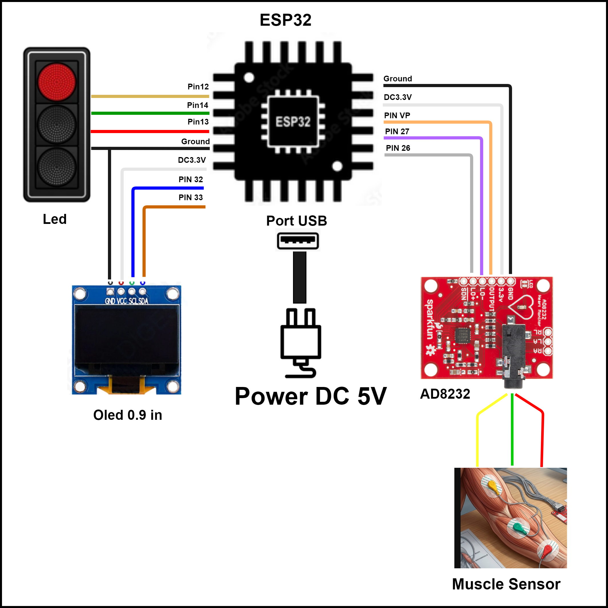
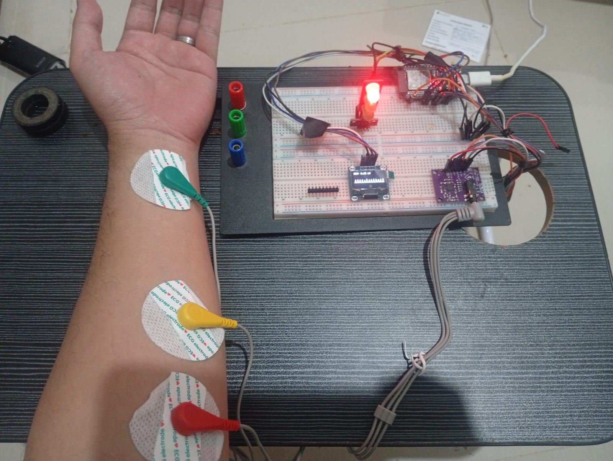
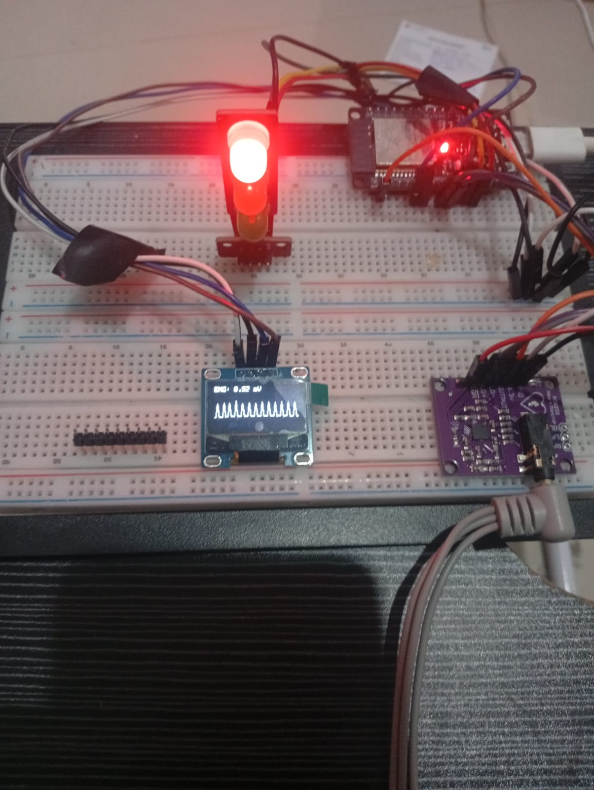

# Bio-Electricity Monitoring and Control System

A simple bio-electricity monitoring system using ESP32, AD8232 heart/muscle sensor, OLED display, and status indicators to detect biopotential signals from human muscle contraction.


## Table of Contents

- [Bio-Electricity Monitoring and Control System](#bio-electricity-monitoring-and-control-system)
  - [Table of Contents](#table-of-contents)
  - [1. Story of Bio-Electricity](#1-story-of-bio-electricity)
    - [1.1 Quantum Level Electron Movement](#11-quantum-level-electron-movement)
    - [1.2 Ion Transport in Blood and Intracellular Space](#12-ion-transport-in-blood-and-intracellular-space)
    - [1.3 Muscle Contraction and Electrical Flow](#13-muscle-contraction-and-electrical-flow)
    - [1.4 Voltage Differences and Robotic Control](#14-voltage-differences-and-robotic-control)
    - [1.5 Remote Patient Monitoring via IoT](#15-remote-patient-monitoring-via-iot)
  - [2. System Architecture](#2-system-architecture)
    - [2.1 Hardware Connections Overview](#21-hardware-connections-overview)
      - [A. AD8232 Sensor Module to ESP32](#a-ad8232-sensor-module-to-esp32)
      - [B. 0.96-inch OLED Display (I2C) to ESP32](#b-096-inch-oled-display-i2c-to-esp32)
      - [C. Traffic Light LED Module to ESP32](#c-traffic-light-led-module-to-esp32)
      - [D. Power Supply](#d-power-supply)
    - [2.2 Signal Flow and Data Processing](#22-signal-flow-and-data-processing)
  - [3. Evidence and Visual Demonstration](#3-evidence-and-visual-demonstration)
    - [3.1 Hardware Setup and Electrode Placement](#31-hardware-setup-and-electrode-placement)
    - [3.2 Real-time Signal Display and Indicator](#32-real-time-signal-display-and-indicator)
  - [4. Video Demonstration](#4-video-demonstration)


## 1. Story of Bio-Electricity

### 1.1 Quantum Level Electron Movement
At the quantum level, everything in our universe is governed by subatomic particles. In our human body, electrons spin and jump across atomic energy levels. Key electrolytes like Sodium ($Na^+$) and Potassium ($K^+$) exist as charged ions because they have gained or lost electrons in their outer shell. This subatomic arrangement establishes microscopic electrical potential across every single living cell membrane.

```
       +--+
       |   Quantum Level: Electron Transfer & Ionization |
       |          Na+ (Sodium)   and   K+ (Potassium)      |
       +--+
                                |
                                v
       +--+
       |  Cellular Level: Membrane Potential Gradient     |
       +--+
```

### 1.2 Ion Transport in Blood and Intracellular Space
Our bloodstream continuously delivers essential nutrients and ions ($Na^+$ and $K^+$) to every tissue. In resting muscle cells, potassium ions ($K^+$) stay primarily inside the cell (intracellular), while sodium ions ($Na^+$) remain outside (extracellular). The cell membrane acts as a dynamic barrier, constantly keeping these charges separate through specialized ion channels and ATP-driven ion pumps.

```
  Extracellular Space (High Na+)
  ======================================= [ Cell Membrane ]
  Intracellular Space (High K+)
```

### 1.3 Muscle Contraction and Electrical Flow
When the brain sends an action potential to move a muscle, gates in the cell membrane open suddenly:
1. $Na^+$ ions rush **into** the intracellular space (Depolarization).
2. $K^+$ ions flow **out** of the intracellular space (Repolarization).

This rapid movement of millions of charged ions across adjacent muscle cell membranes creates a measurable electric current. When thousands of muscle fibers contract together in unison, their individual micro-currents sum up into a bio-electrical wave that travels to the surface of the skin.

### 1.4 Voltage Differences and Robotic Control
By placing non-invasive surface electrodes on the skin above contracting muscles, we can detect minute potential difference voltages (typically in the millivolt range). 

By amplifying and filtering these bio-voltage variations, we can:
- Measure muscle contraction strength in real-time.
- Translate muscle activity into control signals for robotic hands, prosthetic limbs, or assistive exoskeletons to help individuals with disabilities perform daily tasks and work activities.

```
  [ Skin Electrodes ] > [ Amplification ] > [ Motor Actuator ] > [ Robotic Arm Movement ]
```

### 1.5 Remote Patient Monitoring via IoT
By integrating this bio-potential sensing hardware with an Internet of Things (IoT) microcontroller (such as the ESP32), muscle and cardiac biopotential data can be continuously sampled and streamed to cloud dashboards or remote medical monitors over Wi-Fi/Bluetooth. 

This enables healthcare providers to monitor patient health conditions, muscle recovery, or cardiac rhythms in real time from anywhere in the world, facilitating timely medical interventions and remote care.


## 2. System Architecture

The hardware architecture for this bio-electricity IoT monitoring system is visually documented in [`design/architecture.png`](design/architecture.png).



### 2.1 Hardware Connections Overview

The system centers around the **ESP32 Microcontroller**, which handles analog-to-digital signal conversion, display output, visual indicators, and IoT wireless communication.

#### A. AD8232 Sensor Module to ESP32
- **3.3V Pin** $\rightarrow$ `DC3.3V` on ESP32 (Power supply)
- **GND Pin** $\rightarrow$ `Ground` on ESP32 (Common ground reference)
- **OUTPUT Pin** $\rightarrow$ `PIN VP (GPIO36)` on ESP32 (Analog bio-signal output pin)
- **LO- Pin** $\rightarrow$ `PIN 27` on ESP32 (Leads-off negative detection pin)
- **LO+ Pin** $\rightarrow$ `PIN 26` on ESP32 (Leads-off positive detection pin)
- **SDN Pin** $\rightarrow$ Shutdown control line connected to microcontroller for power management.
- **Electrode Cable Jack (3.5mm)** $\rightarrow$ Connects three color-coded lead wires (Red, Yellow, Green) directly to muscle surface electrodes on the human body.

#### B. 0.96-inch OLED Display (I2C) to ESP32
- **VCC Pin** $\rightarrow$ `DC3.3V` on ESP32 (Power supply)
- **GND Pin** $\rightarrow$ `Ground` on ESP32 (Ground connection)
- **SCL Pin** $\rightarrow$ `PIN 32` on ESP32 (I2C Clock line)
- **SDA Pin** $\rightarrow$ `PIN 33` on ESP32 (I2C Data line)

#### C. Traffic Light LED Module to ESP32
- **Red LED Pin** $\rightarrow$ `Pin 12` on ESP32 (Indicates high muscle signal or alert state)
- **Yellow LED Pin** $\rightarrow$ `Pin 14` on ESP32 (Indicates moderate muscle activity)
- **Green LED Pin** $\rightarrow$ `Pin 13` on ESP32 (Indicates baseline or normal state)
- **GND Pin** $\rightarrow$ `Ground` on ESP32 (Common ground)

#### D. Power Supply
- **Port USB** $\rightarrow$ Connected to a standard 5V DC USB power source (`Power DC 5V`) supplying regulated power to the ESP32 board and all peripheral components.


### 2.2 Signal Flow and Data Processing

```
+-+      +-+      +-+      +-+
|  Muscle Electrodes| > |   AD8232 Module   | > |  ESP32 ADC (VP)   | > |  OLED / LED / IoT |
|  (3 Surface Leads)|      | (Amplifier/Filter)|      | (Data Processing) |      | (Visual & Cloud)  |
+-+      +-+      +-+      +-+
```

1. **Signal Acquisition**: Three surface electrodes attached to the forearm capture microscopic voltage fluctuations generated during muscle flexion.
2. **Analog Conditioning**: The AD8232 integrated circuit amplifies the weak millivolt signals and filters out environmental electromagnetic noise and baseline drift.
3. **Microcontroller Sampling**: The ESP32 receives the amplified analog signal on `PIN VP` (Analog-to-Digital Converter channel) while monitoring contact integrity via `PIN 26` (`LO+`) and `PIN 27` (`LO-`).
4. **Data Presentation & Transmission**:
   - Computes signal strength in millivolts ($mV$).
   - Plots live waveform graphs and numerical voltage values on the 0.96-inch OLED display via I2C interface (`PIN 32` & `PIN 33`).
   - Controls status LEDs (`Pin 12`, `Pin 13`, `Pin 14`) to provide instant visual feedback on contraction intensity.
   - Transmits telemetry data via Wi-Fi/IoT protocols for remote monitoring.


## 3. Evidence and Visual Demonstration

The experimental setup and functional prototype testing are documented in the [`ss/`](ss/) folder.

### 3.1 Hardware Setup and Electrode Placement



**Detailed Description of Evidence 1 ([`ss/1.jpeg`](ss/1.jpeg)):**
- **Non-Invasive Surface Electrodes**: Three disposable ECG/EMG gel electrodes are attached along the muscular fascia of the human forearm:
  - **Red Electrode**: Primary positive sensing channel placed on the upper muscle belly.
  - **Yellow Electrode**: Negative sensing channel placed lower on the forearm along the muscle fiber axis.
  - **Green Electrode**: Reference / Ground electrode placed on neutral tissue to eliminate common-mode noise.
- **Breadboard Circuit Implementation**: 
  - The prototype circuit is assembled on a dual-bus solderless breadboard.
  - The **ESP32 development board** is mounted at the top right, wired to the power rail and communication lines.
  - The **AD8232 heart/muscle module** (purple PCB) receives lead signals through a 3.5mm audio jack connector.
  - The **0.96-inch OLED screen** is placed centrally to display real-time signal telemetry.
  - The **traffic light module** at the top illuminates a bright red indicator light when high contraction signals or active states are detected.


### 3.2 Real-time Signal Display and Indicator



**Detailed Description of Evidence 2 ([`ss/2.jpeg`](ss/2.jpeg)):**
- **Close-up Monitoring View**: Shows the prototype active and processing bio-potential signals during arm muscle flexion.
- **OLED Display Output**: 
  - Displays numerical voltage magnitude readings (e.g., `EMG: 0.52 mV`).
  - Displays a continuous real-time bio-potential waveform graph reflecting muscle contraction waves.
- **Visual Alert System**:
  - The top LED module illuminates a high-brightness Red light, providing instant physical feedback when the bio-electric voltage exceeds the preset threshold during muscle movement.
- **Circuit Stability**: Confirms low noise, clean waveform rendering, and stable power delivery across all sensors and microcontroller peripherals during active operation.

---

## 4. Video Demonstration

Watch the live functional demonstration of the IoT Bio-Electricity system on YouTube:

[](https://www.youtube.com/shorts/5yRmZoh6HkQ)

📺 **Direct Link**: [Watch Video Demo on YouTube Shorts](https://www.youtube.com/shorts/5yRmZoh6HkQ)

